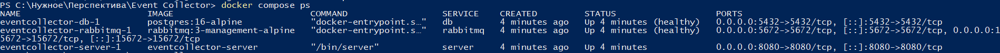
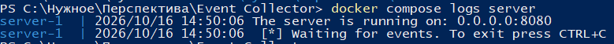
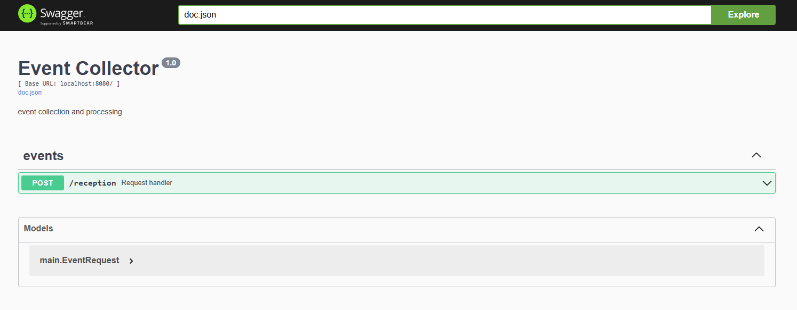
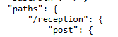
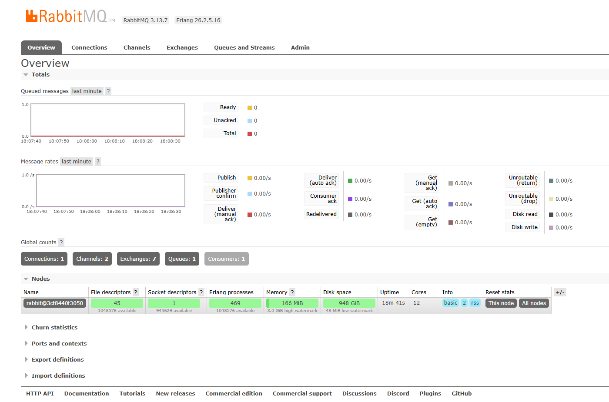
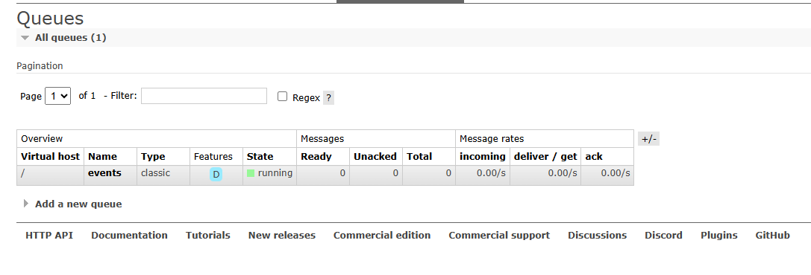
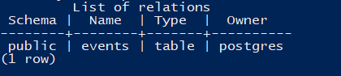
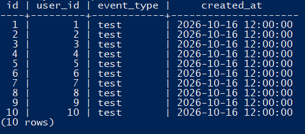

# requirements
Go 1.23+
PostgreSQL 16+
RabbitMQ 3+

# launch
docker compose up --build

# docker
docker compose ps

# logs
docker compose logs server

# http api
for ($i = 1; $i -le 10; $i++) {
    $body = "{`"user_id`":$i,`"event_type`":`"test`",`"timestamp`":`"2026-10-16T12:00:00Z`"}"
    Invoke-RestMethod -Uri "http://localhost:8080/reception" -Method Post -ContentType "application/json" -Body $body
}

# swagger ui
http://localhost:8080/swagger/index.html

http://localhost:8080/swagger/doc.json

# rabbitmq
http://localhost:15672

# postgresql
docker compose exec db psql -U postgres -d events -c "\dt"

docker compose exec db psql -U postgres -d events -c "SELECT * FROM events;"

# completion
docker compose down